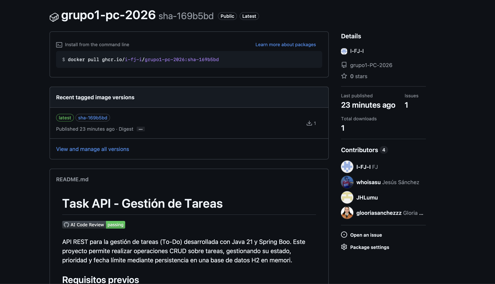

# Boletín 5: Entrega Continua (CD)

## Resumen de commits

| # | Mensaje del commit | Qué se hizo | Autor | Enlace |
|---|--------------------|-------------|-------|--------|
| 1 | `feat(release): añadido el pipeline de publicación` | Creación de `.github/workflows/release.yml` para automatizar el empaquetado y subida de la imagen a GitHub Packages usando `docker/metadata-action`. | Fran | 57aa9c086d45ef248909a10bc7eaa65d7d0fcbf4 |

## Detalle por commit

### 1. `feat(release): añadido el pipeline de publicación`

- **Qué se hizo:** Se implementó un flujo de GitHub Actions que se dispara al integrar código en `main` o al publicar etiquetas de versión. El workflow construye la imagen Docker del proyecto y la publica en GitHub Container Registry (`ghcr.io`) autenticándose con el token nativo de GitHub.
- **Autor:** Jiahui
- **Relación con el boletín:** [Parte A (Pipeline de publicación)](#parte-a---pipeline-de-publicación).
- **Uso de IA:** No.

## Descripción narrativa de lo hecho en la sesión y relación con los commits

### Parte A - Pipeline de publicación

Para automatizar la Entrega Continua de la aplicación, se implementó un nuevo flujo de trabajo en `.github/workflows/release.yml`. Su función es empaquetar la aplicación en una imagen de contenedor y publicarla automáticamente en **GitHub Container Registry (GHCR)**, de forma que quede vinculada al repositorio en la sección *Packages*.

La pieza fundamental de este workflow es la acción `docker/metadata-action`, que asigna dinámicamente las etiquetas (tags) de la imagen Docker dependiendo del evento que haya disparado la ejecución:

1. **Al fusionar un PR a `main`:** El evento `push` sobre la rama principal activa las reglas `type=sha` y `type=raw,value=latest,enable={{is_default_branch}}`. Esto genera una imagen etiquetada con un identificador único del commit (`sha-<hash>`) y actualiza el tag `latest`, apuntando siempre a la versión más reciente del código integrado.
2. **Al publicar una etiqueta de versión (`vX.Y.Z`):** Si se sube un tag de Git, el workflow extrae la versión y genera etiquetas semánticas (`type=semver`). Por ejemplo, para la versión `v1.2.3`, GHCR publicará etiquetas para `1.2.3`, `1.2` y `1`, además del `sha-<hash>` invariable. El tag `latest` se ignora aquí al no tratarse de la rama por defecto.

La autenticación para subir la imagen a `ghcr.io` se resuelve de forma nativa utilizando `secrets.GITHUB_TOKEN`, sin necesidad de gestionar o configurar credenciales de plataformas externas.

